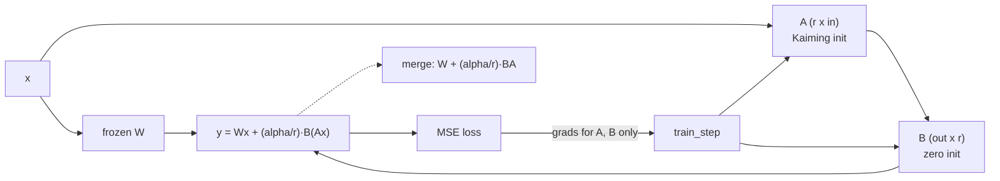

# Jagadish-lora-finetuning

[](https://github.com/jagadishmazure-jpg/Jagadish-lora-finetuning/actions/workflows/ci.yml)
[](https://github.com/jagadishmazure-jpg/Jagadish-lora-finetuning/actions/workflows/codeql.yml)


**LoRA fine-tuning from scratch in numpy: frozen base weights, trainable low-rank adapters, manual backprop, merge and unmerge, and adapter swapping. CPU only, no GPU, no model weights.**

> Personal learning and portfolio project. Everything runs offline on synthetic,
> fictional data with no API keys. Nothing is deployed. Numbers in this README
> come from real runs and are re-checked by CI (`scripts/render_docs.py --check`).

## Recruiter summary

- Shows I understand parameter-efficient fine-tuning at the level of the maths, not just a library call.
- Real run: a rank-4 adapter fits a synthetic rank-4 change (loss 57.76 to near zero in 300 steps); merging matches the adapter output to 1e-14; the frozen base is provably unchanged.
- DPO from scratch on the same adapter: 16 preference pairs, loss 0.69 to 0.0008 in 200 steps, all 16 pairs prefer the chosen answer, base weights unchanged (real run below).
- Honest about scale: the demo layer trains 50% of its parameters; the same formula gives 0.39% for a 4096x4096 layer at rank 8.

## Purpose

Full fine-tuning updates every weight. LoRA freezes the pretrained weight `W`
and learns a low-rank update `B·A`, scaled by `alpha/r`, which can be merged back
for no inference overhead. I built it by hand in numpy so every step (init,
scaling, gradients, merge) is visible and tested. Derivation:
[docs/lora-math.md](docs/lora-math.md).

## Architecture



## How it works

- `LoRAConfig` holds rank, alpha and dropout; scaling is `alpha / rank`.
- `LoRALinear` keeps `W` frozen; `A` starts Kaiming-uniform and `B` starts at
  zero, so the adapter begins as no change.
- `train_step` back-propagates by hand through the adapter path only.
- `merge_adapter` folds `(alpha/r)·B·A` into `W`; `unmerge` reverses it.
- `adapter_swap_demo` trains two adapters on two tasks over one shared base.
- `dpo_step` (`lorax/dpo.py`) runs Direct Preference Optimization on an adapter.
  The implicit reward is `log π(y|x) − log π_ref(y|x)` against a frozen
  reference that shares `W`, and the loss is `−log σ(β·(r_w − r_l))`.
  Gradients are written by hand and checked against finite differences in the
  tests. When to fine-tune at all: [docs/when-to-finetune.md](docs/when-to-finetune.md).

Trainable parameters per layer are `r·(in + out)` against `in·out` for full
fine-tuning, so the saving depends on layer size.

## Real code and output

```python
"""Train a LoRA adapter on a synthetic rank-4 task, merge it, swap adapters on one frozen base, and run DPO on an adapter."""
import numpy as np

from lorax import LoRAConfig, LoRALinear, benchmark, merge_adapter
from lorax.dpo import dpo_loss, dpo_step, make_preference_dataset, preference_margin
from lorax.eval import adapter_swap_demo, make_synthetic_task
from lorax.train import train_step

res = benchmark(steps=300)
print(f"Loss before training: {res.base_loss:.4f}, after 300 steps: {res.adapted_loss:.2e}")
print(f"Trainable params in this 16x16 demo layer: {res.trainable_params} of {res.full_params} "
      f"({100 * res.trainable_params / res.full_params:.0f}%)")

d, r = 4096, 8  # arithmetic only: r*(in+out) vs in*out for one 4096x4096 projection
print(f"Same formula for a 4096x4096 layer at rank 8: {r * 2 * d:,} of {d * d:,} "
      f"({100 * r * 2 * d / (d * d):.2f}%)")

w_base, _, (x, y) = make_synthetic_task(seed=0)
layer = LoRALinear(16, 16, LoRAConfig(rank=4, alpha=8.0, dropout=0.0), rng=np.random.default_rng(1))
layer.W = w_base.copy()
frozen = layer.W.copy()
layer.train()
for _ in range(300):
    train_step(layer, x, y, 0.1)
merged = merge_adapter(layer.eval())
gap = float(np.max(np.abs(merged.forward(x) - layer.forward(x))))
print(f"Merged vs adapter output, max abs difference: {gap:.2e}")
print("Frozen base weight unchanged by training:", bool(np.array_equal(layer.W, frozen)))

swap = adapter_swap_demo()
print("Adapter swap losses on the shared base:",
      {k: f"{v:.2e}" for k, v in swap["swapped_losses"].items()})

# DPO on the adapter: 16 preference pairs, 200 steps, frozen base and reference.

cfg = LoRAConfig(rank=2, alpha=8.0, dropout=0.0)
policy = LoRALinear(8, 6, cfg, rng=np.random.default_rng(21))
ref = LoRALinear(8, 6, cfg, rng=np.random.default_rng(1021))
ref.W = policy.W.copy()
policy.train()
x, y_w, y_l = make_preference_dataset(n=16, seed=22)
w0 = policy.W.copy()
loss0 = dpo_loss(policy, ref, x, y_w, y_l)
for _ in range(200):
    dpo_step(policy, ref, x, y_w, y_l, beta=1.0, lr=0.5)
m = preference_margin(policy, ref, x, y_w, y_l)
print(f"DPO: loss {loss0:.4f} -> {dpo_loss(policy, ref, x, y_w, y_l):.4f}, mean margin {m.mean():.2f}, "
      f"pairs preferring the chosen answer {(m > 0).sum()}/16, base W unchanged: {np.array_equal(policy.W, w0)}")
```

Output of `python examples/demo.py` (real run, re-checked in CI):

<!-- run: python examples/demo.py -->
```text
Loss before training: 57.7639, after 300 steps: 2.18e-09
Trainable params in this 16x16 demo layer: 128 of 256 (50%)
Same formula for a 4096x4096 layer at rank 8: 65,536 of 16,777,216 (0.39%)
Merged vs adapter output, max abs difference: 1.07e-14
Frozen base weight unchanged by training: True
Adapter swap losses on the shared base: {'task_a': '1.66e-10', 'task_b': '1.44e-22'}
DPO: loss 0.6931 -> 0.0008, mean margin 12.89, pairs preferring the chosen answer 16/16, base W unchanged: True
```
<!-- /run -->

## How to run

```bash
git clone https://github.com/jagadishmazure-jpg/Jagadish-lora-finetuning.git
cd Jagadish-lora-finetuning
python -m pip install numpy pytest
python -m pytest -q          # offline, no keys
python examples/demo.py
python scripts/render_docs.py --check   # documented output still matches
```

Test suite size (real collection, re-checked in CI):

<!-- run: python scripts/count_tests.py -->
```text
41 tests collected
```
<!-- /run -->

## Guardrails

- The base weight is never written by training; the demo checks it byte for byte.
- Config validation rejects a rank larger than the layer allows.
- Merge equivalence is tested, so a merged model behaves like the adapter.
- DPO only moves `A` and `B`. The base `W` and the reference adapter are checked unchanged after training.

## Limitations

- One linear layer on synthetic data; no transformer, tokenizer or real model.
- The synthetic targets are exact rank-r changes, so near-zero loss is expected by design.
- At this demo's size LoRA trains 50% of parameters; the under-1% figure only holds for large layers.
- DPO here is a one-layer toy: random prompt embeddings and arbitrary preference pairs, one token per answer. It shows the loss and gradients, not alignment quality.
- No quantisation (QLoRA), optimiser state or multi-adapter serving.
- `adapter_swap_demo` returns `base_unchanged: True` as a constant; the demo script checks it directly instead.

## Built vs planned

| Capability | Status | Where |
|---|---|---|
| Config and LoRALinear | Built | `lorax/config.py`, `lorax/lora.py` |
| Manual backprop through the adapter | Built | `lorax/train.py` |
| Merge and unmerge | Built | `lorax/merge.py` |
| Benchmark and adapter swap | Built | `lorax/eval.py` |
| DPO loss and hand-written gradients on the adapter | Built | `lorax/dpo.py` |
| Real model fine-tune with PEFT on a GPU | Planned | docs/implementation-guide.md |
| QLoRA | Planned | not started |

## Implementation guide

The step-by-step path from this offline build to an Azure deployment is in
[docs/implementation-guide.md](docs/implementation-guide.md). None of it has been
run; it is a plan.

## Related repositories

| Repo | How it relates |
|---|---|
| [Jagadish-dspy-prompt-optimizer](https://github.com/jagadishmazure-jpg/Jagadish-dspy-prompt-optimizer) | Adapting behaviour through prompts instead of weights |
| [Jagadish-llm-evals-observability](https://github.com/jagadishmazure-jpg/Jagadish-llm-evals-observability) | Evaluating a fine-tuned model before release |
| [Jagadish-ai-learning-lab](https://github.com/jagadishmazure-jpg/Jagadish-ai-learning-lab) | Other from-scratch learning notebooks |

## Documentation

- [LoRA maths](docs/lora-math.md)
- [When to fine-tune vs RAG vs prompting](docs/when-to-finetune.md)
- [Concepts](knowledge/01-concepts.md)
- [Diagrams](knowledge/02-architecture.md)
- [Implementation guide (Azure)](docs/implementation-guide.md)
- [Interview points](docs/interview-points.md)
- [Security policy](SECURITY.md)

## Project layout

```
lorax/
  config.py  LoRAConfig
  lora.py    LoRALinear: frozen W, adapters A and B
  train.py   manual backprop, MSE
  merge.py   merge / unmerge
  eval.py    benchmark, adapter swap
  dpo.py     DPO loss, implicit reward, manual gradients
examples/demo.py  the run shown above
tests/       CPU-only pytest suite
```

## License

MIT, see [LICENSE](LICENSE). All data is synthetic; every organisation and person is fictional.
