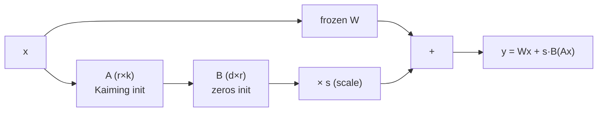
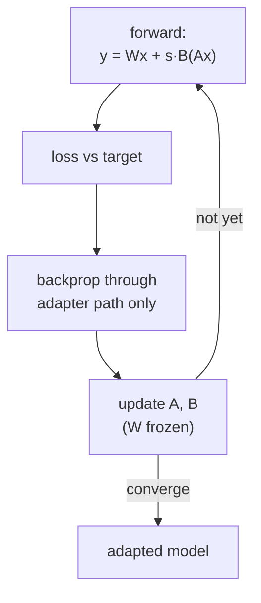
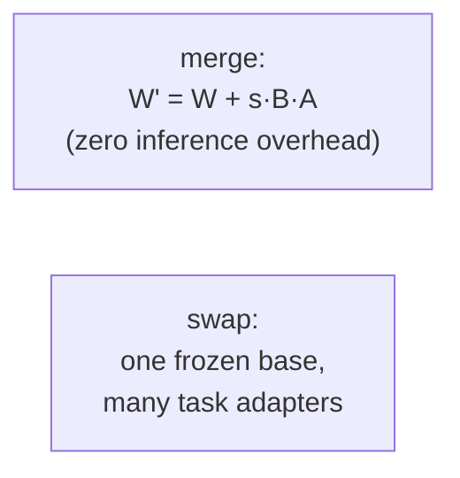

# LoRA fine-tuning: architecture

## Forward pass (adapter path)

At init, B = 0 → the adapter is a no-op. Backprop trains A and B only.

## Training loop (adapter-only)

## Deployment: merge / swap

